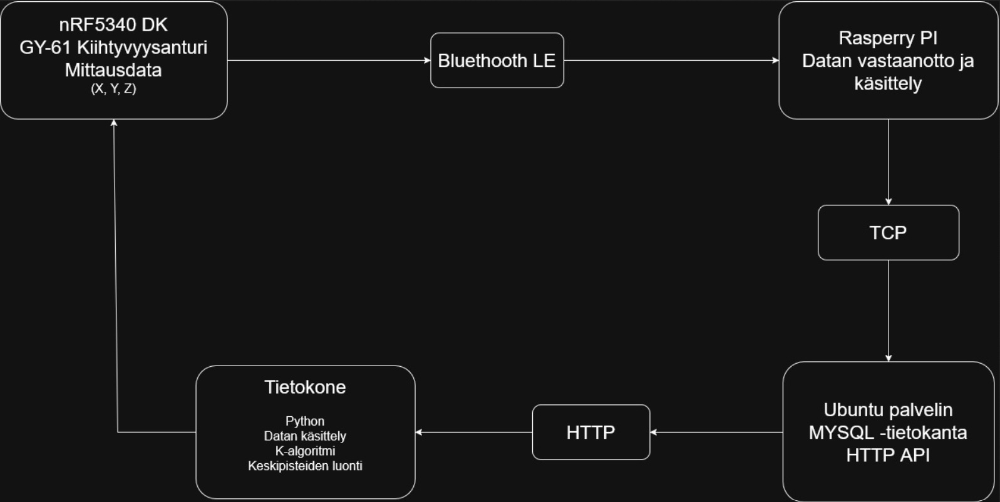

# TL_sovellusprojekti-2026
---
Tietoliikenteen sovellusprojekti - Leevi Alakörkkö &amp; Leo Jokiranta

# Projektin tavoitteet
---

Projektin tavoitteena on suunnitella ja toteuttaa yksinkertainen IoT-järjestelmä, joka tunnistaa laitteen asennon kiihtyvyysanturilta kerätyn datan perusteella.
Järjestelmän mittauslaitteena toimii Nordic Semiconductor nRF5340 Development Kit, johon on liitetty GY-61-kiihtyvyysanturi. Anturi mittaa kiihtyvyyttä kolmella akselilla (X, Y ja Z), ja mittausdata välitetään langattomasti Bluetooth Low Energyn (BLE) avulla Raspberry Pi -laitteelle.

Raspberry Pi vastaanottaa ja käsittelee mittausdatan sekä välittää sen TCP-yhteyden kautta Linux-palvelimella sijaitsevaan MySQL-tietokantaan. Tallennettua dataa haetaan HTTP-rajapinnan kautta Python-ohjelmalla jatkokäsittelyä ja koneoppimista varten.

Projektin lopputuloksena toteutetaan järjestelmä, joka pystyy tunnistamaan ennalta määriteltyä laitteen asentoa K-Means-algoritmilla muodostettujen keskipisteiden avulla.Tunnistus tapahtuu vertaamalla uutta mittausdataa tallennettuihin keskipisteisiin ja valitsemalla lähin keskipiste.

# Järjestelmän arkkitehtuuri
---

Järjestelmän tiedonkulku:

1.	nRF5340 Development Kit: Kerää kiihtyvyysanturin mittausdataa.

2.	Bluetooth Low Energy: Välittää mittausdatan langattomasti Raspberry Pi -laitteelle.

3.	Raspberry Pi: Vastaanottaa ja purkaa Bluetoothin kautta saadun datan sekä välittää sen TCP-yhteydellä palvelimelle.

4.	Linux-palvelin ja MySQL: Tallentavat mittausdatan tietokantaan.

5.	HTTP API ja Python: Python-ohjelmalla haetaan tietokannasta mittausdataa HTTP-rajapinnan kautta ja käsitellään sitä koneoppimista varten.

6.	K-Means: Muodostaa mittausdatasta keskipisteet, joiden avulla nRF5340 pystyy tunnistamaan laitteen asennon.

# Käytetyt teknologiat ja komponentit
---

| Komponentti | Käyttötarkoitus |
|---|---|
| nRF5340 Development Kit | Mittauslaitteen pääohjain ja asennontunnistuksen suorittaminen |
| GY-61-kiihtyvyysanturi | Kiihtyvyyden mittaaminen X-, Y- ja Z-akseleilla |
| Nordic Zephyr SDK | Kehitysalustan ohjelmiston kehittäminen ja laitteiston hallinta |
| Bluetooth Low Energy (BLE) | Mittausdatan langaton siirtäminen Raspberry Pi -laitteelle |
| Raspberry Pi | Toimii mittauslaitteen ja palvelimen välisenä yhdyskäytävänä |
| Ubuntu Server | Palvelinympäristö tietokannan ja tiedonsiirron ylläpitämiseen |
| MySQL | Mittausdatan tallentaminen ja hallinta |
| HTTP API | Tallennetun mittausdatan hakeminen jatkokäsittelyä varten |
| Python | Mittausdatan hakeminen, käsittely ja koneoppimisen toteuttaminen |
| K-Means | Mittausdatan luokittelu ja asentojen tunnistamiseen tarvittavien keskipisteiden muodostaminen |

